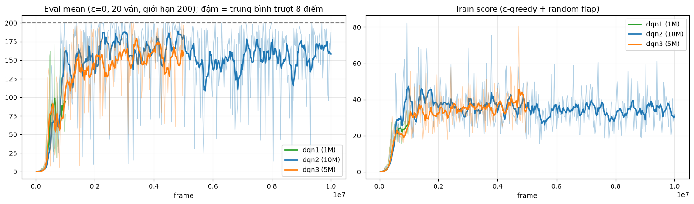
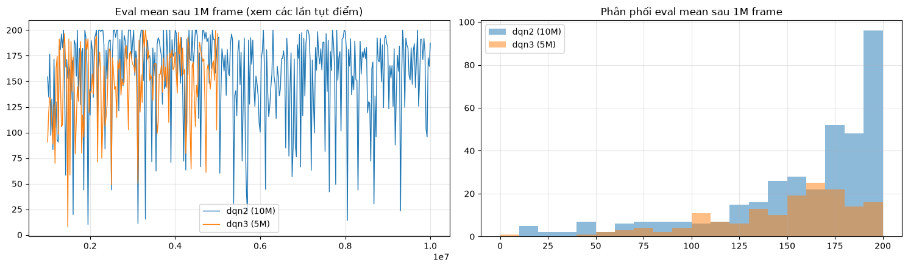
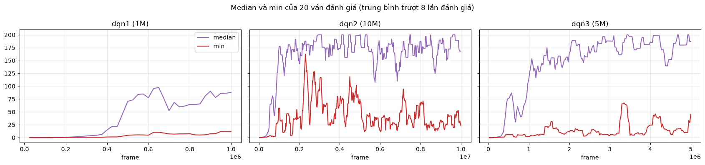
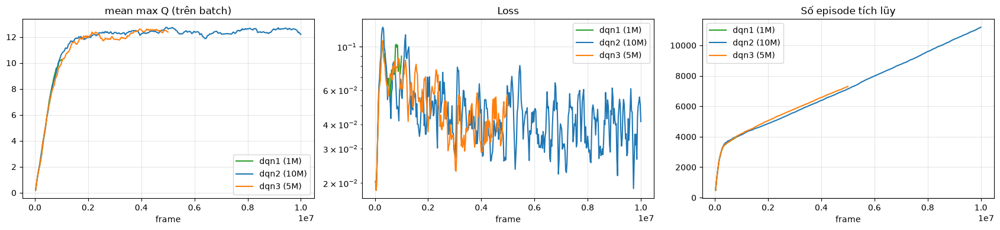
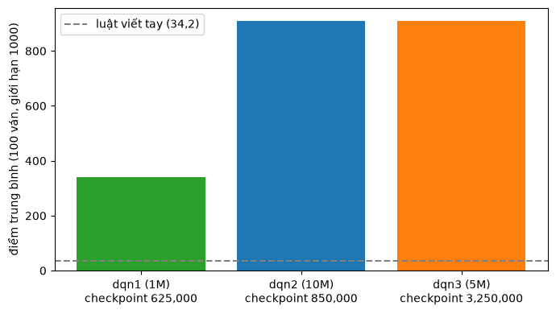

# FlappyBird DQN

Một agent học chơi [`flappy-bird-gymnasium`](https://github.com/markub3327/flappy-bird-gymnasium) 0.4.0 bằng học tăng cường (RL), không được biết luật chơi. Phương pháp là **DQN kèm Double DQN và Dueling Network**, mạng nơ-ron viết bằng TensorFlow/Keras.

Kết quả chính: qua 3 lần chạy cùng một cấu hình, checkpoint tốt nhất đạt trung bình **908,8 và 910,7 ống mỗi ván** trên 100 ván đánh giá (giới hạn 1.000 ống, ε = 0), so với 0 của chơi ngẫu nhiên và 34,2 của luật viết tay. Hai checkpoint này lấy ở khung hình 850.000 và 3.250.000, không phải cuối run (mục 6.5).

## 1. Bài toán

Chim luôn rơi xuống; bấm thì chim vỗ cánh bật lên. Ống chạy từ phải sang trái, chim phải lọt qua khe giữa mỗi cặp ống. Chạm ống hoặc đất là thua; điểm là số cặp ống đã vượt.

- **Observation**: 12 số, gồm 3 ống gần nhất (vị trí ngang, mép trên và mép dưới của khe, mỗi ống 3 số) và 3 số của chim (độ cao, vận tốc dọc, góc nghiêng). Chạy với `use_lidar=False`.
- **Hành động**: {IDLE, FLAP}.
- **Reward**: +0,1 mỗi khung hình còn sống; +1 khi vượt ống; −0,5 khi bay lên trên mép màn hình; −1 khi va chạm (ván kết thúc).
- **Ván chơi không có giới hạn thời gian**, và phân tích luật chơi cho thấy có cách chơi không bao giờ va chạm.
- **Mốc so sánh**: chơi ngẫu nhiên 0 ống; luật viết tay (vỗ cánh khi chim sắp thấp hơn khe) trung bình 34,2 ống.

Chi tiết và thuật ngữ: [Problem_Definition.md](Problem_Definition.md) mục 1.

## 2. Mô hình MDP

| Thành phần | Trong FlappyBird |
|---|---|
| S | Bộ 12 số trên; thỏa Markov Property nên dùng thẳng, không ghép nhiều khung hình |
| A | {IDLE, FLAP} |
| T | Luật vật lý của trò chơi; yếu tố ngẫu nhiên duy nhất là độ cao khe của ống mới (8 mức, đều nhau) |
| R | Bảng reward ở mục 1 |
| γ | 0,99. Một agent không bao giờ chết nhận tổng reward chiết khấu khoảng 12 |
| Trạng thái kết thúc | Va chạm |

Agent không biết T và R, chỉ thấy các transition `(s, a, r, s')`.

## 3. Vì sao chọn DQN

Lập luận gồm 9 bước, tóm tắt như sau (đầy đủ ở [Problem_Definition.md](Problem_Definition.md) mục 3):

| Câu hỏi | Lựa chọn | Lý do chính |
|---|---|---|
| Giải thẳng bằng quy hoạch động? | Không; học từ kinh nghiệm (online) | Không biết T, R; cỡ bài toán khoảng 10^8 trạng thái |
| Học luật chơi hay học cách chơi? | Model-free | Sai số của luật tự học cộng dồn qua khoảng 38 khung hình giữa hai ống |
| Đánh giá hay tìm cách chơi? | Active RL | Chưa có cách chơi tốt để đánh giá |
| Học V hay Q? | Q(s, a) | Chọn hành động từ V cần T |
| Q-Learning hay SARSA? | Q-Learning (off-policy) | Học giá trị của cách chơi ε = 0 và cho phép dùng lại dữ liệu cũ |
| Lưu Q bằng gì? | MLP (Q-Network) | Bảng quá lớn; tổng có trọng số của 12 số thô không biểu diễn được việc chọn ống cần vượt |
| Làm sao học ổn định? | Experience Replay + Target Network | Dữ liệu liên tiếp giống nhau; mục tiêu dịch chuyển theo mạng |
| Cải tiến thêm? | Double DQN, Dueling Network; Prioritised Replay để dành | Hai hành động có giá trị sát nhau nên Q dễ bị đánh giá quá cao. Prioritised Replay chỉ thêm khi điểm đánh giá tăng rồi tụt và không hồi phục |
| Hướng khác có hợp hơn? | Không | Policy Gradient, Actor-Critic là on-policy, không dùng lại được dữ liệu cũ; Deep DPG dành cho hành động liên tục; Model-Based Deep RL gặp sai số cộng dồn; CNN trên ảnh không cần vì 12 số đã đủ |

## 4. Cài đặt

Các thành phần tách rời, kiểm thử được bằng dữ liệu giả: bộ bọc môi trường (module duy nhất import `gymnasium`), Q-Network, Replay Buffer, Agent (ε-greedy, Target Double DQN, đồng bộ Target Network), và script huấn luyện/đánh giá.

Target theo Double DQN:

```
a*     = argmax_a' Q(s', a'; w)        mạng chính chọn hành động
Target = r                             nếu terminated
Target = r + γ · Q(s', a*; w⁻)         trong mọi trường hợp còn lại, kể cả truncated
```

Ba điều dễ sai: không đưa transition sinh ra sau `terminated` vào agent (thư viện vẫn chạy chim đã chết); với `truncated` (đạt `score_limit`) vẫn cộng giá trị tương lai; `info["score"]` chỉ để chấm điểm, không thuộc state.

Cấu hình dùng trong cả 3 lần chạy (từ `CONFIG` của notebook Colab):

| Tham số | Giá trị |
|---|---|
| Mạng | MLP 12 → 256 → 256 → đầu ra Dueling (V + A), ReLU |
| Optimizer | Adam, learning rate 1e-4 |
| γ | 0,99 |
| Replay | 100.000 transition; bắt đầu học khi có 10.000 |
| Batch / tần suất cập nhật | 64 / mỗi 4 khung hình |
| Đồng bộ Target Network | mỗi 1.000 lần cập nhật |
| ε | 1,0 → 0,01 tuyến tính trong 100.000 khung hình đầu |
| `random_flap_prob` | 0,1 (khi thử ngẫu nhiên, FLAP với xác suất 10%, thay vì 50%) |
| Đánh giá | mỗi 25.000 khung hình: 20 ván, ε = 0, giới hạn 200 ống, seed 12345 |

Cơ sở của các giá trị này và mã giả: [Implementation_Notes.md](Implementation_Notes.md) mục 5 và 6.

## 5. Thực nghiệm

Ba lần chạy dùng cùng cấu hình và cùng seed huấn luyện (0), chỉ khác tổng số khung hình:

| Run | Số khung hình | Số phiên Colab | Thời gian (tổng các phiên) | Thư mục |
|---|---|---|---|---|
| dqn1 | 1 triệu | 2 | 76,5 phút | `Results/dqn_run1` |
| dqn2 | 10 triệu | 3 | 1.080,6 phút ≈ 18,0 giờ | `Results/dqn_run2` |
| dqn3 | 5 triệu | 2 | 545,2 phút ≈ 9,1 giờ | `Results/dqn_run3` |

Cần lưu ý bốn điểm về thiết kế thực nghiệm:

- `total_frames` không tác động vào thuật toán, vì lịch ε kết thúc ở 100.000 khung hình. Ba run vì vậy là **ba lần lặp của cùng một thí nghiệm**, dừng ở ba mốc khác nhau, chứ không phải ba cấu hình thời lượng.
- Cùng seed không bảo đảm tái lập. Mỗi run chạy qua nhiều phiên Colab và được chạy tiếp (resume) từ trạng thái đã lưu. dqn1 và dqn3 trùng tuyệt đối tới 175.000 khung hình rồi tách ra; dqn2 khác ngay từ bản ghi đầu.
- Thời gian ở bảng trên là tổng đỉnh `session_minutes` của từng phiên, vì giá trị này về 0 mỗi lần resume. Đây là mức tối thiểu: phần chạy sau lần đánh giá cuối của mỗi phiên không được ghi.
- dqn3 có 199 bản ghi đánh giá thay vì 200. Lần đánh giá ở 4.025.000 bị mất vì phiên Colab bị ngắt đúng lúc đang đánh giá.

Cuối mỗi run, `best.weights.h5` được đánh giá lại trên 100 ván, ε = 0, giới hạn 1.000 ống. Phân tích đầy đủ: [Results_Analysis.ipynb](Results_Analysis.ipynb), đọc `history.jsonl` của 3 run và lưu hình vào `Results/figures/`.

## 6. Kết quả

Mỗi điểm đánh giá định kỳ là 20 ván, ε = 0, giới hạn 200 ống. Đánh giá cuối là 100 ván, giới hạn 1.000 ống.

### 6.1. Đường học



- Sau khi tách nhau, ba run đi theo ba đường khác xa: eval mean tại 400k là 75,1 / 13,85 / 127,05 và tại 500k là 161,45 / 58,3 / 7,35 (dqn1 / dqn2 / dqn3). Điểm chung là điểm đánh giá bắt đầu bứt lên trong khoảng 350–500k khung hình; đây là đặc điểm của cấu hình.
- dqn1 dừng ở 1M khi đường học còn dao động mạnh (nửa sau từ 18,7 đến 171,6) và chưa lần nào đạt 190.
- dqn2 chạm trần 200 lần đầu ở 850k. dqn3 đạt ≥ 190 lần đầu ở 1,275M (191,15) và chạm 200 lần đầu ở 3,25M. Sau đó cả hai dao động quanh 150–190 chứ không đi lên đều.
- Train score thấp hơn eval nhiều. Cuối run, trung bình 20 bản ghi cuối chỉ là 32,7 ống mỗi ván (dqn2) và 38,8 (dqn3), trong khi eval với ε = 0 đạt 150–200. Lúc huấn luyện vẫn còn ε = 0,01 và `random_flap_prob = 0,1`, và vài hành động ngẫu nhiên trong một ván dài đã đủ làm chim chết.

### 6.2. Tóm tắt số liệu

| | dqn1 (1M) | dqn2 (10M) | dqn3 (5M) |
|---|---|---|---|
| Eval mean tốt nhất (giới hạn 200) | 171,6 | 200 | 200 |
| Khung hình của `best.weights.h5` | 625k | 850k | 3,25M |
| Khung hình đầu tiên có mean ≥ 100 | 475k | 525k | 400k |
| Khung hình đầu tiên có mean ≥ 190 | chưa đạt | 850k | 1,275M |
| Số lần đánh giá có mean ≥ 190 | 0 | 98 | 16 |
| Trung bình 10 lần đánh giá tới mốc 1M | 85,7 | 144,6 | 90,9 |
| Trung bình 10 lần đánh giá tới mốc 5M | – | 180,8 | 160,7 |
| Trung bình 10 lần đánh giá cuối run | 85,7 | 164,7 | 160,7 |
| mean max Q ở cuối run | 10,26 | 12,20 | 12,39 |

- **Không so được thời lượng huấn luyện bằng cách đặt ba run cạnh nhau.** Ở cùng mốc 1M, ba run đã chênh nhau 85,7 / 144,6 / 90,9, tức chênh lệch ngẫu nhiên giữa các lần chạy đã lớn cỡ hiệu ứng muốn đo.
- So trong cùng một run thì đáng tin hơn. Eval mean trung bình theo từng triệu khung hình của dqn2 là: (1M–2M] 143,5; (2M–3M] 176,8; (3M–4M] 159,9; (4M–5M] 171,1; (5M–6M] 143,5; (9M–10M] 158,6. Điểm ngừng tăng từ khoảng 2–3M, sau đó chỉ dao động.
- dqn2 (10M) mất khoảng gấp đôi dqn3 (5M): 18,0 so với 9,1 giờ. Phần lớn thời gian là đánh giá. Một chu kỳ 25.000 khung hình mất khoảng 1 phút khi agent còn kém, nhưng 3,1–4,3 phút khi cả 20 ván đánh giá đều đạt 200 ống.

### 6.3. Độ ổn định



Sau 1M khung hình, eval mean của dqn2 có trung bình 157,0 (độ lệch chuẩn 44,1) và trung vị 172,0. dqn3 có trung bình 148,4 (độ lệch chuẩn 36,8) và trung vị 157,0. Giá trị thấp nhất là 10,1 (dqn2) và 8,0 (dqn3). dqn1 chỉ có một điểm sau 1M nên không vẽ.

- Sau khi đã đạt 190–200, điểm vẫn nhiều lần tụt mạnh, ví dụ dqn2 còn 81,6 tại 7,5M và dqn3 còn 79,6 tại 4,25M.
- Các lần tụt thường hồi phục ngay ở lần đánh giá kế tiếp và không đi xuống dần. Mỗi điểm chỉ có 20 ván, nên một ván chết sớm đủ kéo trung bình xuống nhiều.
- Dữ liệu hiện có chưa tách được hai cách giải thích: (a) nhiễu đo của 20 ván, (b) chính sách thật sự dao động, ví dụ vì replay buffer 100k làm quên tình huống hiếm. Cách (b) là **giả thuyết**, chưa kiểm chứng.
- Điều kiện để thêm Prioritised Replay là điểm đánh giá *tăng rồi tụt và không hồi phục* ([Problem_Definition.md](Problem_Definition.md) Bước 8). Ở đây điểm có tụt nhưng hồi phục ngay, nên điều kiện **chưa thỏa**.



Hình trên dùng trung bình trượt qua 8 lần đánh giá. Ở dqn2 và dqn3, median phần lớn thời gian nằm trong khoảng 150–200 còn min hầu hết dưới 50. Nghĩa là **đa số ván đạt giới hạn, và mean bị kéo xuống bởi một vài ván chết sớm**. Điểm của từng ván không được lưu, nên chưa biết các ván chết sớm có chung một kiểu khe ống hay không.

### 6.4. Q-value, loss và số episode



- mean max Q tăng tới khoảng 10,0–10,7 ở mốc 1M và vào vùng 12 từ khoảng 2M. Sau đó nó ổn định quanh 12,2–12,5 ở dqn2 và dqn3, không bùng nổ, và nằm dưới ngưỡng 12,9 mà [Implementation_Notes.md](Implementation_Notes.md) coi là dấu hiệu đánh giá quá cao.
- Không có run đối chứng bỏ Double DQN, nên chưa thể quy việc Q ổn định cho Double DQN.
- Loss giảm từ khoảng 0,08–0,1 xuống khoảng 0,04–0,05 rồi đứng yên. Nó không báo trước các lần tụt điểm, nên không dùng được làm tín hiệu dừng.
- Số episode tăng chậm dần vì mỗi ván dài hơn: dqn2 chỉ có khoảng 11,2k episode trong 10M khung hình.

### 6.5. Đánh giá cuối (`best.weights.h5`, 100 ván, giới hạn 1.000 ống)

| Run | Checkpoint (khung hình) | Trung bình | Trung vị | Thấp nhất | Cao nhất | Ván chạm giới hạn | max Q trung bình |
|---|---|---|---|---|---|---|---|
| dqn1 | 625.000 | 341,6 | 294 | 3 | 1.000 | 2/100 | 8,16 |
| dqn2 | 850.000 | 908,8 | 1.000 | 1 | 1.000 | 90/100 | 9,95 |
| dqn3 | 3.250.000 | 910,7 | 1.000 | 53 | 1.000 | 83/100 | 12,00 |



- **Bảng này không so sánh 1M / 10M / 5M.** `best.weights.h5` được lưu khi eval mean vượt *hẳn* mức cao nhất trước đó, mà điểm bị chặn ở 200. Vì vậy với dqn2 và dqn3, checkpoint được giữ là lần đầu chạm trần. 9,15 triệu khung hình sau của dqn2 và 1,75 triệu khung hình sau của dqn3 chưa được đánh giá 100 ván, dù `last.weights.h5` và các snapshot vẫn còn.
- Cả ba **vượt xa mốc so sánh**: chơi ngẫu nhiên đạt 0, luật viết tay đạt 34,2.
- Checkpoint 850k của dqn2 và checkpoint 3,25M của dqn3 ngang nhau (908,8 so với 910,7). Vậy dữ liệu **không** cho thấy cần tới 5M khung hình, vì một checkpoint chưa tới 1M (khoảng 1 giờ trên Colab) đã đạt mức này. Ngược lại, checkpoint 625k của dqn1 chỉ đạt 341,6: kết quả ở cùng một mốc phụ thuộc nhiều vào từng lần chạy.
- max Q trung bình trên các trạng thái đã đi qua lần lượt là 8,16 / 9,95 / 12,00. Hai giá trị đầu thấp hơn vùng 11,9–12,9 dự đoán cho agent chơi tốt, phù hợp với việc chúng là checkpoint sớm. Không trạng thái nào vượt 12,9.
- Seed 12345 vừa dùng để chọn `best` vừa dùng cho đánh giá cuối, nên đánh giá cuối không hoàn toàn độc lập với bước chọn mô hình.

### 6.6. Kết luận

1. Cấu hình hiện tại học được: checkpoint tốt nhất của dqn2 và dqn3 đạt khoảng 910 trên 1.000 ống, 83–90% ván chạm giới hạn.
2. Chưa kết luận được cần huấn luyện bao lâu. Ba run là ba lần lặp, và chúng chênh nhau nhiều ngay ở cùng một mốc. Riêng trong dqn2, điểm đánh giá ngừng tăng từ khoảng 2–3M khung hình.
3. Kết quả dao động mạnh giữa các lần chạy: ở mốc 1M, trung bình 10 lần đánh giá gần nhất là 85,7 / 144,6 / 90,9.
4. Điểm đánh giá dao động cả sau khi agent đã giỏi, nhưng thường hồi phục ngay. Chưa tách được nhiễu đo với dao động thật của chính sách.

## 7. Hạn chế và bước tiếp theo

- Chỉ có một cấu hình với ba lần lặp. Không có run đối chứng bỏ Double DQN hoặc Dueling Network, nên chưa có bằng chứng thực nghiệm cho từng cải tiến.
- Mỗi điểm đánh giá định kỳ chỉ có 20 ván, và điểm bị chặn ở 200. Tiêu chí lưu `best` vì vậy giữ lần đầu chạm trần. Điểm từng ván của đánh giá cuối không được lưu.
- Notebook Colab chỉ đặt seed cho ván đánh giá đầu tiên. Chuỗi ống của các ván sau phụ thuộc vào số ống đã sinh trước đó, tức phụ thuộc chính sách đang được chấm, nên các checkpoint khác nhau không được chấm trên cùng chuỗi ống.
- Nguyên nhân các lần tụt điểm (nhiễu đo hay replay buffer quên tình huống hiếm) chưa được kiểm chứng.
- Kết quả được sinh trên Colab (Python 3.13, TensorFlow 2.21.0, Keras 3.13.2; dqn1 chạy trên GPU T4), khác môi trường local ở mục 9.

Thử tiếp, theo thứ tự:

1. Đánh giá 100 ván cho `last.weights.h5` và một số snapshot, để so sánh đúng theo thời lượng.
2. Sửa tiêu chí chọn `best`, ví dụ so sánh bằng `>=` hoặc dùng nhiều ván hơn / giới hạn cao hơn khi điểm đã chạm trần.
3. Giảm ε về 0,001 khi agent đã vượt được nhiều ống, như [Implementation_Notes.md](Implementation_Notes.md) mục 5 đã gợi ý.
4. Chỉ thêm Prioritised Replay nếu điểm đánh giá tụt mà không hồi phục.

## 8. Video demo

Mỗi run có một video agent tự chơi (checkpoint `best.weights.h5`, ε = 0, seed 12345, dừng khi vượt 20 ống). Cả ba cùng seed nên gặp cùng 20 ống đầu, và đều vượt hết sau 777 khung hình; vì vậy ba video gần như giống nhau và chỉ minh họa cách chơi, không cho thấy khác biệt giữa các run.

| dqn1 (1M khung hình) | dqn2 (10M khung hình) | dqn3 (5M khung hình) |
|:---:|:---:|:---:|
|  |  |  |
| [mp4 gốc](Results/dqn_run1/agent_play.mp4) | [mp4 gốc](Results/dqn_run2/agent_play.mp4) | [mp4 gốc](Results/dqn_run3/agent_play.mp4) |

GIF được chuyển từ mp4 gốc (30 khung hình/giây, 288 × 512) xuống 15 khung hình/giây, rộng 216 pixel và 64 màu để nhẹ hơn (khoảng 3,4 MB mỗi file).

## 9. Tái lập

- Môi trường local: conda env `flappybird` (Python 3.11, TensorFlow 2.21, Keras 3.15.1, gymnasium 1.3.0, flappy-bird-gymnasium 0.4.0, chạy trên CPU), danh sách gói trong `requirements.txt` (Windows). Kết quả ở mục 6 được sinh trên Colab với Python 3.13 và Keras 3.13.2; notebook Colab chỉ ghim gymnasium và flappy-bird-gymnasium.
- Huấn luyện: mở `Code/FlappyBird_Colab.ipynb` trên Google Colab và chỉnh `CONFIG` (`run_name`, `total_frames`). Notebook lưu toàn bộ trạng thái lên Drive tại mỗi lần đánh giá và tự tiếp tục khi chạy lại.
- Lưu ý khi dùng thư viện: đặt `use_lidar=False`; huấn luyện với `render_mode=None` (chế độ `"human"` bị khóa 30 khung hình/giây); gọi `reset()` sau `terminated` hoặc `truncated`. `checkenv.py` gọi `env.step()` hai lần mỗi vòng, một lỗi đã biết (xem `Implementation_Notes.md` mục 1).
- Kiểm thử: `pytest` đã cài trong env, nhưng repo chưa có file test nào.

## 10. Tài liệu tham khảo

- Tóm tắt lý thuyết trong [Knowledge/](Knowledge/): MDP, Reinforcement Learning, Deep Reinforcement Learning.
- [flappy-bird-gymnasium](https://github.com/markub3327/flappy-bird-gymnasium) 0.4.0.
